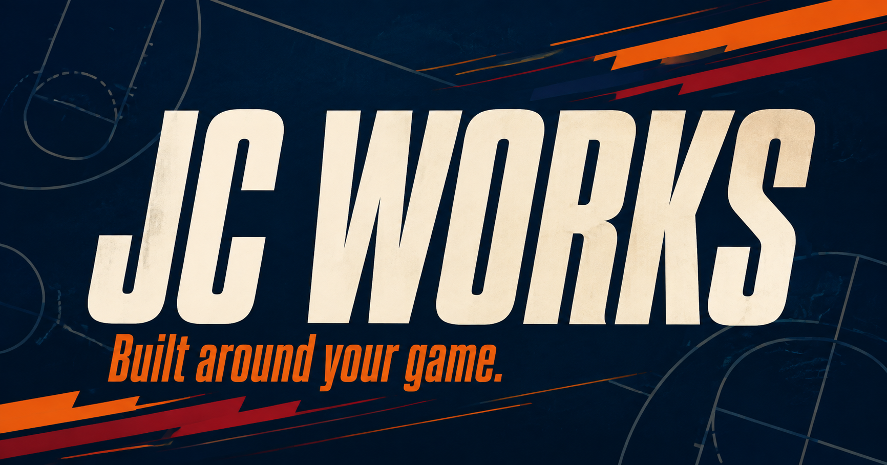
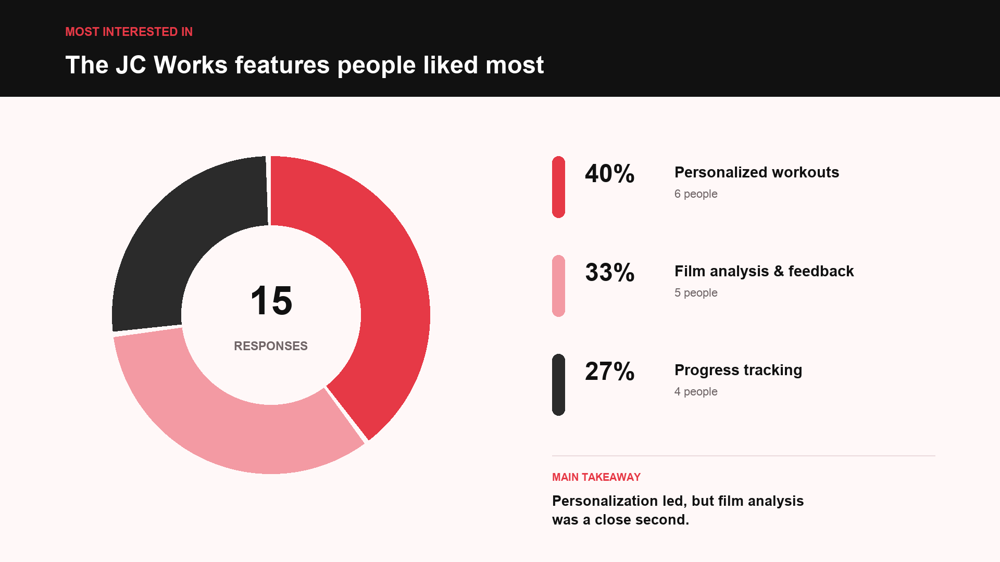
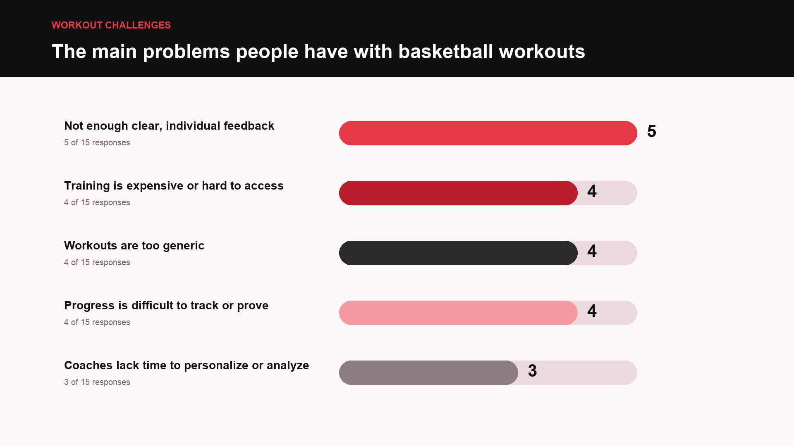

# JC Works

**You're not generic. Your workout shouldn't be either.**

JC Works is an AI basketball training website for high-school and college players. It creates personalized workouts, saves workout results, tracks progress, and compares basketball film to give players clear cues they can use in their next workout.

[Open the live JC Works website and film-analysis demo](https://jc-works-basketball.jordanacodio.chatgpt.site/)

## The problem

Private trainers can be expensive or unavailable, and many workouts online are too generic. Players may spend time or money on workouts that are not based on their position, goals, weaknesses, equipment, or actual results.

## What JC Works does

- Uses a short player assessment to create a personalized 30-45 minute workout
- Adjusts the workout to the player's position, goals, weaknesses, equipment, and available time
- Lets players enter makes and attempts
- Saves player information and past workout results with Firebase
- Shows workout history and recommends what to focus on next
- Compares a made and missed free throw using body-tracking measurements
- Gives simple visual cues and turns the film feedback into a focused workout

## Film-analysis demo

The final demo compares two of my free throws: one make and one miss. MediaPipe body tracking helps measure movement in the background. Instead of covering the video with distracting dots, lines, and fast-changing numbers, JC Works shows only the feedback the player needs.

In the made shot, the analysis identifies a balanced rise and centered finish. In the missed shot, my shooting hand moves right before returning toward the center, and the ball misses right. JC Works turns that difference into the cue: **"Straight up, straight through."** A still frame also shows the balanced base, soft knee bend, and centered ball position.

The film-analysis demo is included directly in the [live website](https://jc-works-basketball.jordanacodio.chatgpt.site/).

## What I learned from feedback

I collected feedback from 15 people: five players, five parents, and five coaches.

- 6 were most interested in personalized workouts
- 5 were most interested in film analysis and feedback
- 4 were most interested in progress tracking

The most common workout challenges were a lack of clear individual feedback, expensive or unavailable training, workouts that were too generic, difficulty proving progress, and limited coach time.

| Most interested in | Workout challenges |
| --- | --- |
|  |  |

## Technology used

- React and Next.js for the website
- Firebase Authentication and Firestore for player accounts and saved workout results
- MediaPipe Pose Landmarker for body-motion tracking
- AI-assisted workout creation and film-analysis testing
- OpenAI Sites for publishing the live prototype

## Final reflection

[Read my final JC Works reflection](docs/JCWorks-Final-Reflection.pdf)

## Important note

JC Works is a class prototype. The film-analysis feedback is an experiment and should be personally checked instead of automatically treated as professional coaching or medical advice.
